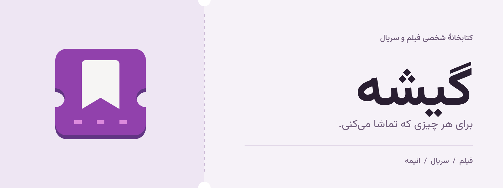
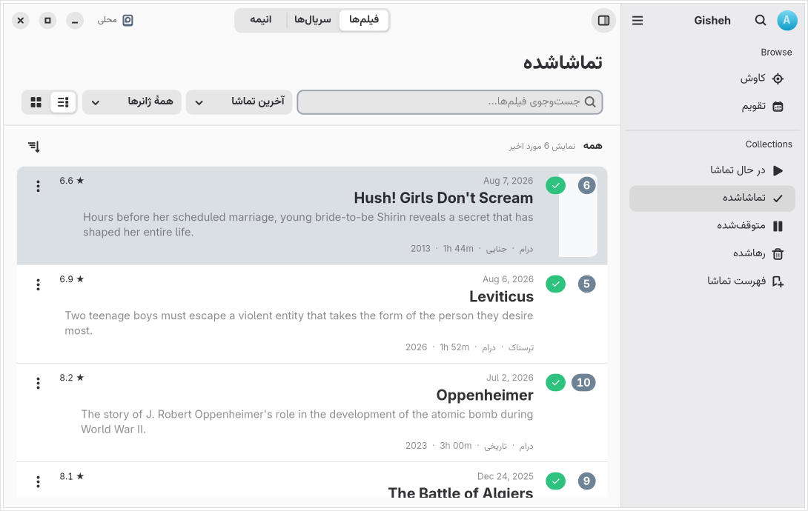
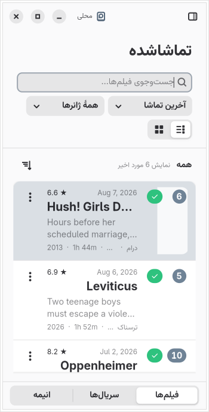
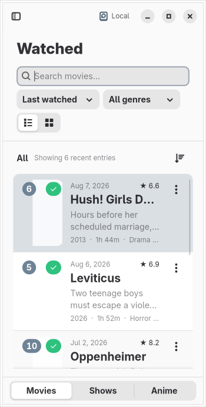

<picture>
  <source media="(prefers-color-scheme: dark)" srcset="docs/assets/cover-fa-dark.png">
  
</picture>

<p align="center">
  <a href="#نصب">نصب</a> ·
  <a href="#امکانات">امکانات</a> ·
  <a href="#ساخت-برنامه">ساخت برنامه</a> ·
  <a href="https://github.com/arashe023/Gisheh/issues">گزارش مشکل</a> ·
  <a href="README.md">English</a>
</p>

# گیشه

برای چیزهایی که می‌خواهید ببینید فهرست بسازید، تماشاشده‌ها را ثبت کنید و
قسمت بعدی سریال را فراموش نکنید. گیشه برنامه‌ای برای لینوکس با GTK 4 و
libadwaita است؛ برای نگهداری فیلم، سریال و انیمه در یک کتابخانه.
می‌توانید بدون حساب کاربری شروع کنید یا برای همگام‌سازی سابقهٔ تماشا به
Simkl متصل شوید.

<picture>
  <source media="(prefers-color-scheme: dark)" srcset="docs/assets/library-fa-dark.png">
  
</picture>

<p align="center"><sub>تصویر واقعی برنامه با کتابخانهٔ نمونه؛ هنگام ثبت تصویر اینترنت قطع بوده و جای پوسترها خالی است.</sub></p>

## امکانات

- **کتابخانه‌تان را مرتب کنید.** عنوان‌ها را بین در حال تماشا، تماشاشده،
  متوقف‌شده، رهاشده و فهرست تماشا جابه‌جا کنید؛ با جست‌وجو، فیلتر و نمای
  فهرستی یا شبکه‌ای.
- **جایی را که رسیده‌اید ثبت کنید.** قسمت‌های دیده‌شده، تاریخ تماشا و امتیاز
  شخصی هر عنوان را نگه دارید.
- **چیزی برای دیدن پیدا کنید.** عنوان‌ها، تصویرها، توضیحات و بازیگران را از
  TMDB ببینید و زبان اطلاعات آن را مستقل از زبان رابط انتخاب کنید.
- **سابقهٔ تماشایتان را مرور کنید.** فعالیت ماهانه و سالانه، ژانرهای پرتکرار
  و امتیازها در نمایه در دسترس‌اند.
- **نسخه‌ای از کتابخانه نگه دارید.** خروجی بگیرید یا کتابخانه را برگردانید؛
  با پشتیبان‌گیری خودکار و بازیابی وضعیت ذخیره‌شدهٔ آسیب‌دیده.
- **با ظاهر سیستم کار کنید.** رابط از زبان، جهت نوشتار و ظاهر روشن یا تیرهٔ
  سیستم پیروی می‌کند. فارسی و انگلیسی همراه برنامه‌اند.

<details>
<summary>نمای پنجرهٔ باریک در فارسی و انگلیسی</summary>

<p align="center">
  
  
</p>

</details>

## نصب

**نامزد انتشار فعلی: `1.5.0-rc1`.** این نسخهٔ آزمایشی برای تست است.
بسته‌ها پس از انتشار در [GitHub Releases](https://github.com/arashe023/Gisheh/releases)
قرار می‌گیرند؛ گیشه هنوز در Flathub عرضه نشده است.

بستهٔ `.flatpak` مناسب معماری دستگاه را دریافت کنید و از پوشهٔ همان فایل
دستورهای نصب را اجرا کنید. برای نامزد انتشار x86_64:

```sh
flatpak install --user ./Gisheh-1.5.0-rc1-x86_64.flatpak
flatpak run io.github.arashe023.Gisheh//beta
```

برنامه به GNOME 50 runtime نیاز دارد. آدرس مخزن runtime در بسته ثبت شده تا
Flatpak بتواند آن را هنگام نصب دریافت کند. برای به‌روزرسانی بستهٔ مستقل،
بستهٔ نسخهٔ جدیدتر را نصب کنید. روش بررسی checksum و ساخت بسته در
[راهنمای انتشار](docs/RELEASING.md) آمده است.

## اولین اجرا

۱. برای شروع بدون حساب، **کتابخانهٔ محلی** را انتخاب کنید؛ برای همگام‌سازی
سابقهٔ تماشا، حساب **Simkl** را متصل کنید.

۲. **کاوش** را باز کنید، نام فیلم یا سریال را جست‌وجو کنید و آن را به یکی از
فهرست‌ها اضافه کنید.

۳. با ادامهٔ تماشا، وضعیت عنوان، قسمت‌های دیده‌شده یا امتیاز آن را تغییر دهید.

ساخت استاندارد برنامه دسترسی TMDB را همراه دارد؛ نیازی به ساختن کلید API
ندارید. رکوردهای ذخیره‌شدهٔ محلی آفلاین هم در دسترس‌اند؛ جست‌وجو، اطلاعات
کاتالوگ و دریافت تصویرهای جدید به اینترنت نیاز دارند.

حالت محلی کتابخانه را به Simkl ارسال نمی‌کند. در حالت Simkl، تغییرات
کتابخانه به حساب متصل‌شده فرستاده می‌شوند. جزئیات ذخیره‌سازی، اطلاعات ورود،
نسخه‌های پشتیبان و سرویس‌ها در [داده‌ها و حریم خصوصی](docs/PRIVACY.md) آمده است.

## ساخت برنامه

در [GNOME Builder](https://apps.gnome.org/Builder/) این مخزن را باز کنید،
`build-aux/flatpak/io.github.arashe023.Gisheh.json` را انتخاب کنید و برنامه را
بسازید و اجرا کنید. این manifest از GNOME 50 استفاده می‌کند.

<details>
<summary>ساخت مستقیم: وابستگی‌ها و دستورها</summary>

وابستگی‌ها: Python ≥ 3.11، GTK ≥ 4.12، libadwaita ≥ 1.9، libsecret ≥ 0.20،
PyGObject، pycairo، httpx، Meson ≥ 1.3، Ninja، gettext و ابزارهای توسعهٔ GLib.
typelibهای GTK، Adwaita، PangoCairo و Secret را از بسته‌های توزیع نصب کنید.
تست‌ها به Xvfb، xauth، D-Bus، Ruff، desktop-file-utils و AppStream هم نیاز دارند.

```sh
meson setup build --prefix="$PWD/_install"
meson compile -C build
meson test -C build --print-errorlogs
meson install -C build
./_install/bin/gisheh
```

برای ساخت بدون وابستگی‌های تست، گزینهٔ `-Dtests=false` را به `meson setup`
اضافه کنید.

</details>

## مشارکت

اگر مشکلی پیدا کردید، در [گزارش مشکل](https://github.com/arashe023/Gisheh/issues)
مراحل تکرار، نسخهٔ گیشه، دسکتاپ و روش نصب را بنویسید. برای مشارکت در کد یا
ترجمه، از [CONTRIBUTING.md](CONTRIBUTING.md) شروع کنید.

ترجمه‌های رابط در `po/` هستند و از gettext استفاده می‌کنند. زبان رابط از
سیستم گرفته می‌شود؛ زبان محتوای TMDB تنظیم جداگانه‌ای دارد.

## مستندات

- [معماری](docs/ARCHITECTURE.md): ماژول‌ها، وضعیت برنامه و سرویس‌ها.
- [اعتبارسنجی](docs/VALIDATION.md): بررسی‌های انجام‌شده و محدودهٔ آن‌ها.
- [راهنمای انتشار](docs/RELEASING.md): ساخت و توزیع بسته‌ها.
- [آمادگی انتشار](docs/RELEASE-READINESS.fa.md): فهرست بررسی‌ها و موارد باقی‌مانده.
- [تغییرات](CHANGELOG.md): تغییرات نسخه‌ها.

## منابع و مجوز

گیشه نرم‌افزار آزاد با [مجوز MIT](LICENSE) است و با
[GTK](https://www.gtk.org/) و
[libadwaita](https://gnome.pages.gitlab.gnome.org/libadwaita/) ساخته شده است.

اطلاعات کاتالوگ و تصویرها از [TMDB](https://www.themoviedb.org) تأمین می‌شوند
و [Simkl](https://simkl.com) همگام‌سازی اختیاری حساب را فراهم می‌کند.

This product uses the TMDB API but is not endorsed or certified by TMDB.
