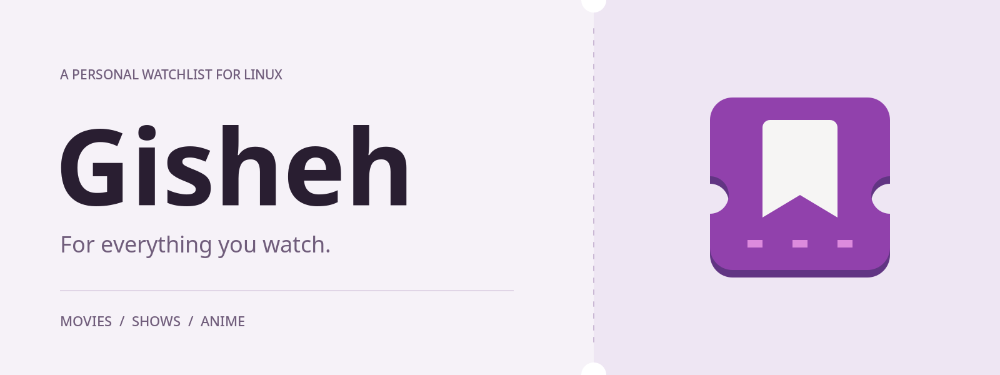
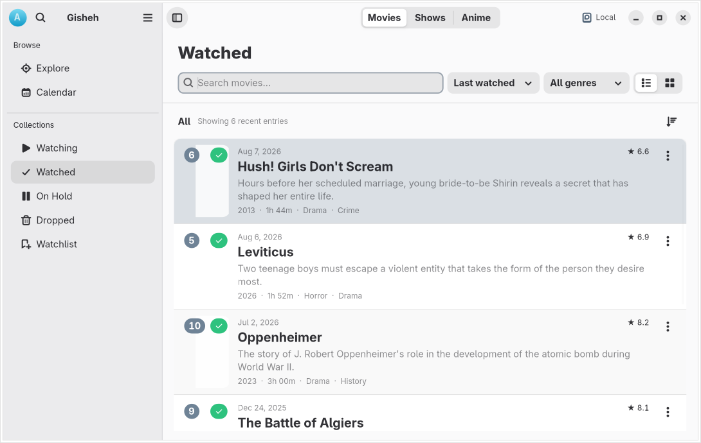
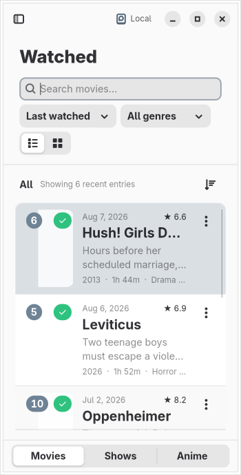
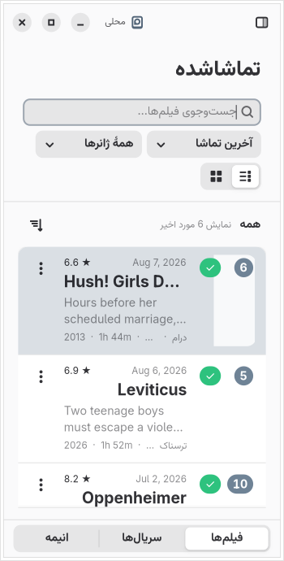

<picture>
  <source media="(prefers-color-scheme: dark)" srcset="docs/assets/cover-en-dark.png">
  
</picture>

<p align="center">
  <a href="#install">Install</a> ·
  <a href="#features">Features</a> ·
  <a href="#build">Build</a> ·
  <a href="https://github.com/arashe023/Gisheh/issues">Report an issue</a> ·
  <a href="README.fa.md">فارسی</a>
</p>

# Gisheh

Keep a watchlist, record what you've watched and pick up where you left off.
Gisheh is a Linux application built with GTK 4 and libadwaita for movies,
TV shows and anime. Use a local library without an account, or connect Simkl
to synchronize your viewing history.

<picture>
  <source media="(prefers-color-scheme: dark)" srcset="docs/assets/library-en-dark.png">
  
</picture>

<p align="center"><sub>A real application screenshot with a sample local library. Captured offline; poster placeholders are intentional.</sub></p>

## Features

- **Keep your library organized.** Move titles between Watching, Watched,
  On Hold, Dropped and Watchlist, with search, filters and list or grid views.
- **Remember your progress.** Track episodes, viewing dates and personal ratings.
- **Find something to watch.** Browse TMDB titles, artwork, descriptions and cast;
  choose the catalog language independently from the interface language.
- **See your viewing habits.** Review monthly and yearly activity, favorite
  genres and ratings in your profile.
- **Keep a copy.** Export and restore your local library, with automatic backups
  and recovery when a saved state cannot be read.
- **Feel at home on Linux.** Follow the system's language, text direction and
  light or dark appearance. English and Persian interfaces are included.

<details>
<summary>See the narrow layout and Persian interface</summary>

<p align="center">
  
  
</p>

</details>

## Install

**Current candidate: `1.5.0-rc1`.** This is a beta for testing. Bundles are
available from [GitHub Releases](https://github.com/arashe023/Gisheh/releases)
when published; Gisheh is not yet listed on Flathub.

Download the `.flatpak` bundle for your architecture, then run these commands
from the directory containing it. For the x86_64 candidate:

```sh
flatpak install --user ./Gisheh-1.5.0-rc1-x86_64.flatpak
flatpak run io.github.arashe023.Gisheh//beta
```

Flatpak needs the GNOME 50 runtime. The bundle includes its runtime-repository
address so Flatpak can obtain the required runtime during installation.
Standalone bundles receive application updates by installing a newer bundle.
See [release instructions](docs/RELEASING.md) for checksums and local packaging.

## First launch

1. Choose a **local library** to start without an account, or connect **Simkl**
   if you want to synchronize your viewing history.
2. Open **Explore**, search for a title and add it to a collection.
3. Update its status, episode progress or rating as you watch.

The standard build includes TMDB application access; you do not need to create
an API key. Saved local records remain available offline. Search, catalog
details and new artwork use TMDB and need an internet connection.

Local mode does not upload your library to Simkl. In Simkl mode, library changes
are sent to the connected account. Read [data and privacy](docs/PRIVACY.md) for
storage, credentials, backups and service details.

## Build

With [GNOME Builder](https://apps.gnome.org/Builder/), open this repository,
select `build-aux/flatpak/io.github.arashe023.Gisheh.json`, then build and run.
The manifest targets GNOME 50.

<details>
<summary>Native build: dependencies and commands</summary>

Required: Python ≥ 3.11, GTK ≥ 4.12, libadwaita ≥ 1.9, libsecret ≥ 0.20,
PyGObject, pycairo, httpx, Meson ≥ 1.3, Ninja, gettext and GLib development tools.
Install the GTK, Adwaita, PangoCairo and Secret GI typelibs provided by your
distribution. Tests also need Xvfb, xauth, D-Bus, Ruff, desktop-file-utils
and AppStream.

```sh
meson setup build --prefix="$PWD/_install"
meson compile -C build
meson test -C build --print-errorlogs
meson install -C build
./_install/bin/gisheh
```

To build without the test dependencies, add `-Dtests=false` to `meson setup`.

</details>

## Contribute

Found a bug? [Open an issue](https://github.com/arashe023/Gisheh/issues) with the
steps to reproduce it, your Gisheh version, desktop and installation method.
Translations and code contributions are welcome; start with
[CONTRIBUTING.md](CONTRIBUTING.md).

Interface translations live in `po/` and use gettext. The interface follows
the system language; TMDB content language is a separate preference.

## Documentation

- [Architecture](docs/ARCHITECTURE.md) — modules, state and service boundaries.
- [Validation](docs/VALIDATION.md) — completed checks and their limits.
- [Release guide](docs/RELEASING.md) — packaging and distribution.
- [Changelog](CHANGELOG.md) — changes between versions.

## Credits and license

Gisheh is free software under the [MIT license](LICENSE), built with
[GTK](https://www.gtk.org/) and
[libadwaita](https://gnome.pages.gitlab.gnome.org/libadwaita/).

Catalog information and artwork are provided by
[TMDB](https://www.themoviedb.org). This product uses the TMDB API but is not
endorsed or certified by TMDB. [Simkl](https://simkl.com) provides optional
account synchronization.
