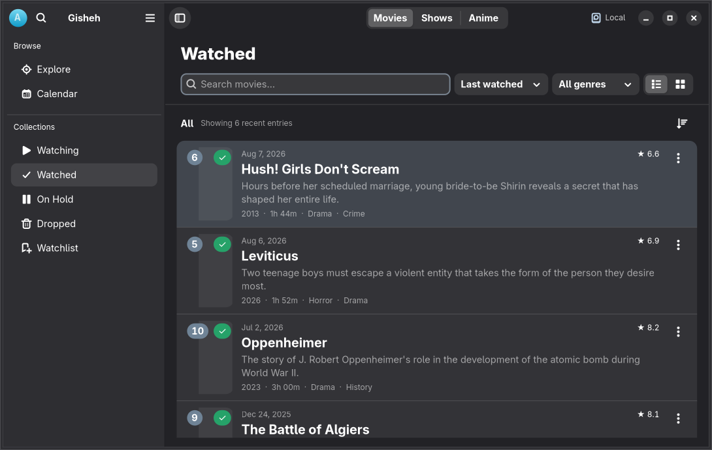

<div align="center">
  
  <h1>Gisheh</h1>
  <p>Keep track of what you watch</p>
</div>

[فارسی](README.fa.md) · [Report an issue](https://github.com/arashe023/Gisheh/issues) · [Contributing](CONTRIBUTING.md)

Gisheh is a GTK 4 and libadwaita application for browsing and tracking movies,
TV shows and anime on Linux. Keep a private library on your device or connect
Simkl to synchronize your viewing history.



## Features

- Discover titles with TMDB search, artwork, descriptions and cast information.
- Organize your library into Watching, Watched, On Hold, Dropped and Watchlist.
- Track episodes, viewing dates and personal ratings.
- Review monthly and yearly viewing activity, favorite genres and ratings.
- Export and restore your local library with automatic recovery backups.
- Use the system's language, light or dark appearance and text direction.
- Choose the TMDB content language independently from its searchable language list.

Local mode requires no account. Catalog search and new artwork need an internet
connection; saved local records remain available offline. Simkl synchronization
is optional. See [data and privacy](docs/PRIVACY.md) for storage and service details.

## Install

The next release is **1.5.0-rc1**, a release candidate for testing. It is not
currently published on Flathub. Downloadable artifacts, when published, are on
[GitHub Releases](https://github.com/arashe023/Gisheh/releases).

To install a locally built or downloaded Flatpak bundle:

```sh
flatpak install --user ./Gisheh-1.5.0-rc1-x86_64.flatpak
flatpak run io.github.arashe023.Gisheh//beta
```

The standard build includes TMDB application access; users do not need to create
an API key. The first-launch screen offers a local library or a Simkl connection.

## Build

### GNOME Builder / Flatpak

Open this repository in [GNOME Builder](https://apps.gnome.org/Builder/) and select
`build-aux/flatpak/io.github.arashe023.Gisheh.json`, then build and run.
The manifest targets GNOME 50. For command-line bundle creation, see
[packaging and release instructions](docs/RELEASING.md).

### Native build

Dependencies: Python ≥ 3.11, GTK ≥ 4.12, libadwaita ≥ 1.9, libsecret ≥ 0.20,
PyGObject, pycairo, httpx, Meson ≥ 1.3, Ninja, gettext and GLib development tools.
Install the corresponding GTK, Adwaita, PangoCairo and Secret GI typelibs from
your distribution. Tests also need Xvfb, xauth, D-Bus, Ruff, desktop-file-utils
and AppStream.

```sh
meson setup build --prefix="$PWD/_install"
meson compile -C build
meson test -C build --print-errorlogs
meson install -C build
./_install/bin/gisheh
```

For a build without the test dependencies, pass `-Dtests=false` to `meson setup`.

## Contribute

Bug reports, translations and code contributions are welcome. Read
[CONTRIBUTING.md](CONTRIBUTING.md) for checks and reporting guidance.
Interface translations use gettext (`po/`); the interface language follows the
system. English and Persian are currently available, including right-to-left
layout. TMDB content language is a separate preference.

[Architecture](docs/ARCHITECTURE.md) · [Validation](docs/VALIDATION.md) · [Changes](CHANGELOG.md)

## Credits and license

Gisheh is free software under the [MIT license](LICENSE). It is an independent
application built with GNOME technologies.

Catalog information and artwork are provided by [TMDB](https://www.themoviedb.org).
This product uses the TMDB API but is not endorsed or certified by TMDB.
[Simkl](https://simkl.com) provides optional account synchronization.
